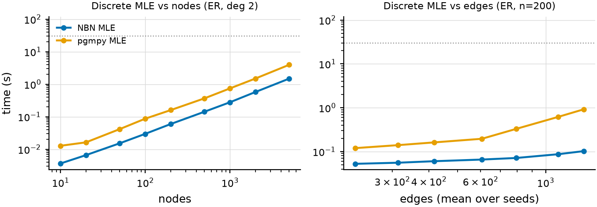
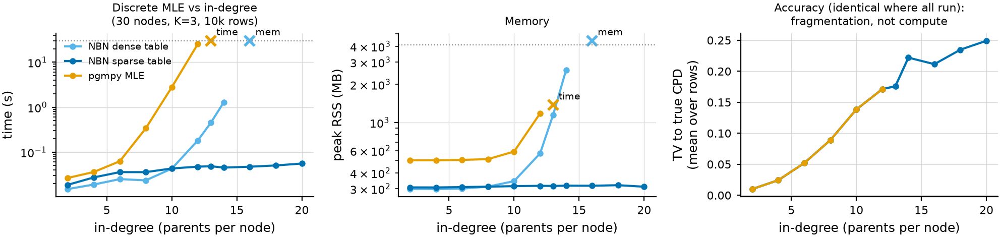
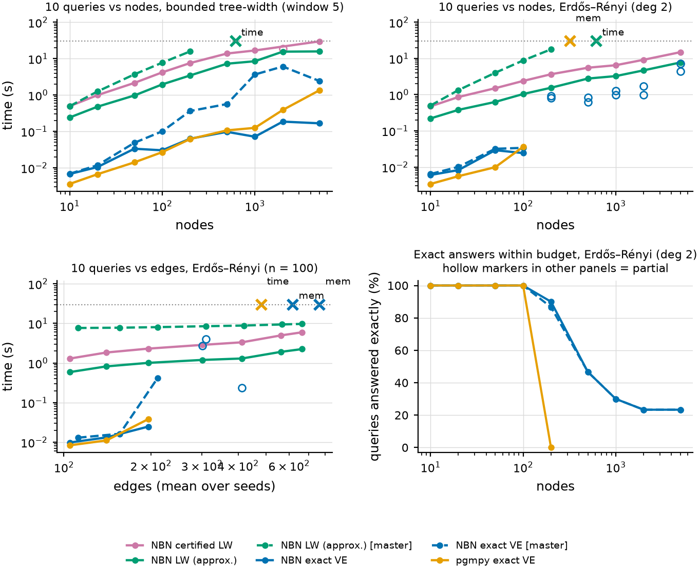
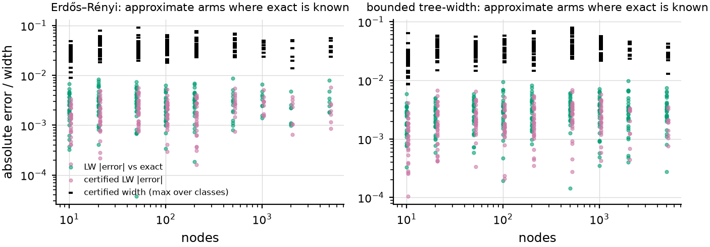
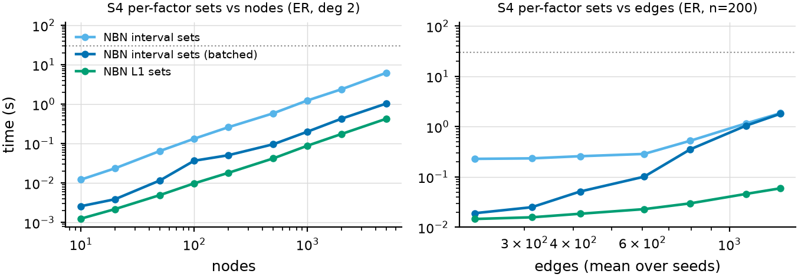
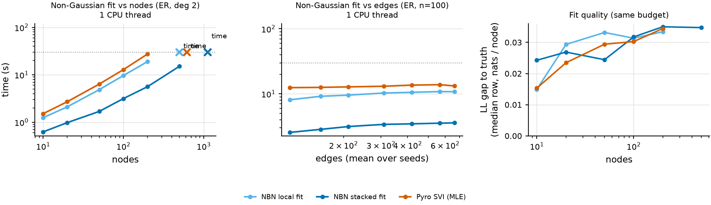
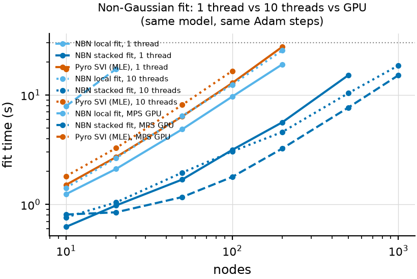
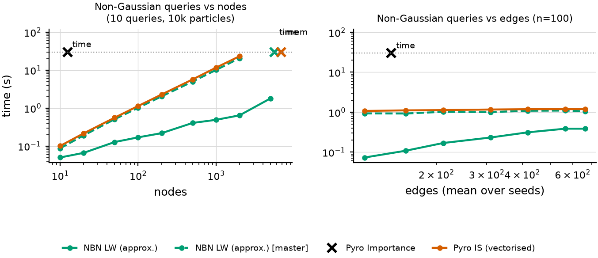

# Can NBN scale with graph size and graph complexity?

Branch `feat/scaling-study` (from `master` @ `61831fa`).  Study run on
2026-10-16 by Alfredo (`alfredo_claude`) for the owner.  All numbers below
come from `results/*.jsonl`, regenerated by the commands at the end.

## Answer in one page

**Yes for graph size, partly for graph complexity — and the part that does
not scale is a theorem, not an implementation detail.**  Under a 1-thread /
4 GB / 30 s budget, after the changes on this branch:

| operation | scales with nodes? | scales with edges? | binding constraint | vs baseline |
|---|---|---|---|---|
| discrete MLE fit | ✅ 5 000 nodes in 1.5 s | ✅ to in-degree 20 with the sparse table (dense: OOM at 16) | data fragmentation: TV error to the truth grows 0.01 → 0.25 with in-degree | pgmpy 2.7× slower at 5 000 nodes, 9× at in-degree 8, times out at in-degree 13 |
| exact discrete queries | ✅ on bounded tree-width (5 000 nodes, 0.16 s / 10 queries) | ❌ exponential in tree-width | tree-width (K&F Thm 9.6; optimal ordering NP-hard, Thm 9.7) | pgmpy 8× slower at 5 000; pgmpy fails at 200 ER nodes where NBN still answers 90% of queries exactly |
| sampling queries (LW) | ✅ 5 000 nodes, any tree-width | ✅ linear in edges | `1/P(e)` (rare evidence), not the graph | 5–32× faster than NBN master; on non-Gaussian queries vectorised Pyro is 36× slower at 2 000 nodes and runs out of memory at 5 000 |
| certified discrete queries | ✅ 5 000 ER nodes, 1.7 s / query | ✅ | `W/P(e)` | new: 518/518 intervals cover the exact answer; median width 0.067 |
| S4 per-factor sets | ✅ 5 000 nodes in 1.35 s (batched KL) | table size `K^(p+1)` | parent-set size (data per row) | 4.6× faster than per-node; bit-identical |
| non-Gaussian neural fit | ✅ linear, 3× smaller constant (stacked); 1 000 nodes on the GPU | ✅ flat in edges | compute: rows × epochs × nodes | sequential NBN and Pyro SVI hit the 30 s budget at 500 nodes, stacked at 1 000 (CPU) |
| non-Gaussian queries | ✅ 5 000 nodes in 1.8 s / 10 queries | ✅ | effective sample size | Pyro vectorised: 23 s at 2 000, OOM at 5 000 |

What changed: 11 semantics-preserving engine changes (§2), all tested; the
two largest effects are the incremental min-fill (exact queries 19–66×
faster than master on 100–2 000-node networks) and barren-node pruning in
likelihood weighting (5–32×).  Two new mechanisms make the "edges" axis tractable where
it can be: `SparseCategoricalTableMechanism` (fit memory `O(N)` instead of
`O(K^(p+1))`) and `certified_query` (sampling answers with a declared
`1 − δ` level, so dense graphs get *guaranteed* answers when exact inference
is impossible).


## 1. Set-up

**Budget ("constrained" scenario).** Every measurement is one fresh process
with **1 CPU thread** (torch + BLAS pinned), an **RSS watchdog at 4 GB**
(kill → `oom`) and a **30 s** limit on the timed region (→ `timeout`).
Imports and data loading are not charged.  A separate **GPU arm** runs the
same cells on Apple MPS (M5); the machine has no CUDA.

**Graphs.** Topological-order random DAGs, `X0 < X1 < …`:

| family | parents of node j | what it stresses |
|---|---|---|
| `er` | `min(j, 8, Poisson(deg))` uniformly among all earlier nodes | size **and** complexity: tree-width grows with n |
| `local` (window 5) | same count, drawn among the 5 previous nodes | size only: tree-width ≤ 5 at any n |
| `fixed` (in-degree sweep) | exactly `min(j, d)` earlier nodes | table size `K^(d+1)` |

x-axes: nodes `n ∈ {10, …, 5000}` at mean in-degree 2, and edges (mean
in-degree 1 … 8 at fixed n).

**Data and truth.** Discrete: K = 3, CPT logits i.i.d. N(0,1) (or additive
logits for the in-degree sweep, so the truth stays compact).  Continuous
non-Gaussian: every node a 3-component Gaussian mixture with means linear in
the parents and skew-normal offsets (`nbn.bench.synthetic`'s
`continuous_nongauss`); marginals are skewed and heavy-tailed (median excess
kurtosis 1.9).  10 000 training rows, 2 000 test rows.

**Methods compared.**

| task | NBN | baseline |
|---|---|---|
| discrete fit | count MLE (`CategoricalTableMechanism`, α = 0), dense or sparse | pgmpy `MaximumLikelihoodEstimator` |
| discrete query `P(Y \| 5 evidence)` ×10 | exact VE (`TensorVariableElimination`, told the memory budget); LW (100k particles); **certified LW** (200k, δ = 0.05) | pgmpy `VariableElimination` (its default `greedy` order; `MinFill` ran out of memory on 100 nodes) |
| S4 per-factor sets (δ split over nodes) | `interval_set` (KL) per node, `interval_sets` batched, `l1_ball_set` | — |
| non-Gaussian fit | MDN K = 3, one hidden layer of 32, 20 epochs, batch 512, Adam 1e-3: `fit(method="local")` (sequential) vs **`fit(method="stacked")`** | Pyro SVI, same model class and steps (no latents ⇒ MLE) |
| non-Gaussian query `P(Y > median \| 3 evidence)` ×10 | LW, 10k particles | Pyro importance sampling: `pyro.infer.Importance` (idiomatic) and a vectorised `plate` version |

"master" rows run the same cell against unmodified NBN `master` (ablation).

## 2. What changed in NBN (all semantics-preserving)

"Semantics-preserving" means: the same estimator, or the same query answer
(exactly for exact methods, in distribution for samplers); each claim has a
test.

| # | change | where | why it is the same | test |
|---|---|---|---|---|
| 1 | incremental greedy min-fill (rescore only the 2-neighbourhood of the eliminated node) | `inference/_elimination_order.py` | identical order to the old loop (500 random graphs) | `test_min_fill_order.py` |
| 2 | evidence is *conditioned out* of the ordering graph (deleted, no fill) and the cheaper of the new and legacy orders is kept | same | the order never changes an answer; K&F §9.3.2, p. 303–307; never costlier by VE factor sizes | `test_min_fill_never_costlier_than_legacy` |
| 3 | `DAG.induced_width` incremental with the historical tie-break | `core/dag.py` | identical value (300 random graphs) | `test_dag_induced_width_fast_path_matches_reference` |
| 4 | LW samples only the ancestral closure of targets ∪ evidence ∪ do | `inference/likelihood_weighting.py` | barren nodes: same joint law of weights and targets (K&F Ex. 3.8, p. 98; Rubenstein et al. 2017, Thm 9) | `test_lw_pruning_*` |
| 5 | categorical sampling by inverse CDF on the normalised table | `mechanisms/parametric/categorical_table.py` | exactly `Categorical(row)`; zero-probability classes never drawn | `test_categorical_sampler_matches_cpt`, `test_zero_probability_class_never_sampled` |
| 6 | LW particles run in passes, only target columns kept | `likelihood_weighting.py` | particles are i.i.d. | `test_lw_particle_chunking_same_answer` |
| 7 | `fit(method="stacked")`: all MDN nodes of one architecture trained as one batched network; closed-form backward of the mixture NLL | `learning/stacked.py`, `learning/fit.py` | per-node objective, Adam (element-wise) and per-node clipping unchanged; only the minibatch order is shared; full-batch runs equal `local` to 2e-6 | `test_stacked_fit.py` |
| 8 | `SparseCategoricalTableMechanism`: stores only parent rows with data + one uniform row | `mechanisms/parametric/sparse_categorical_table.py` | the dense MLE table is uniform on rows without data; identical `log_prob` / `tabulate` / sampling law | `test_sparse_categorical_table.py`, conformance registry |
| 9 | `interval_sets`: all nodes' KL intervals in one vectorised pass | `uncertainty/builders.py` | bit-identical to per-node `interval_set` | `test_interval_sets_identical_to_per_node` |
| 10 | `certified_query`: simultaneous `1 − δ` intervals for a discrete `P(y \| e)` from unnormalised LW | `inference/certified.py` | a new answer type (bounds), not a new model; see §4 | `test_certified_query_*` |
| 11 | `query_width_bounds`, `minor_min_width`, `TensorVariableElimination.plan_width`; `HybridRouter(query_width_check=True)` (opt-in) | `_elimination_order.py`, `tensor_ve.py`, `hybrid.py` | diagnostics; opt-in routing turns some approximate answers exact | `test_router_query_width_check_*` |

## 3. Results

Figures are in `figures/`, full tables in `results/tables.md` (medians over
3 seeds for discrete queries; hollow markers = some queries or seeds failed).

### 3.1 Discrete fitting (vs pgmpy MLE)




* Same estimator: NBN and pgmpy give identical CPTs (same TV error to the
  truth and the same checksum on every problem).
* Nodes (ER, deg 2): NBN 1.48 s vs pgmpy 3.95 s at 5 000 nodes; both linear.
* Edges: pgmpy grows with in-degree (0.12 → 0.92 s at n = 200, deg 1 → 8),
  NBN stays near 0.1 s (one vectorised `scatter_add` per node).
* In-degree stress (30 nodes, K = 3, additive-logit truth): pgmpy 25 s at
  in-degree 12, timeout at 13; dense NBN 1.3 s / 2.6 GB at 14, OOM at 16;
  **sparse NBN 0.05 s / 0.32 GB flat to in-degree 20**, identical estimates.
* The real limit is statistical: the TV error of the MLE to the truth grows
  from 0.01 (in-degree 2) to 0.25 (20) with 10 000 rows — each parent row
  gets fewer data ("data fragmentation"; the sample size needed grows
  exponentially in the in-degree [K&F, Cor. 17.3, p. 775]).  Computing the
  MLE fast does not make it good; past ~10 parents a parametric or neural CPD
  is needed, which *is* a modelling change (not done here).

### 3.2 Discrete queries (vs pgmpy VE)




* Exactness: NBN VE and pgmpy VE agree to 1.9e-7 on 450 queries.
* **Bounded tree-width (window 5)**: exact VE scales to 5 000 nodes —
  NBN 0.16 s per 10 queries (pgmpy 1.36 s, NBN master 2.42 s; at 2 000 nodes
  NBN 0.09 s vs master 6.1 s).  Before this branch, ~97% of the query time
  was the min-fill ordering (graph copy + full rescoring per step).
* **Erdős–Rényi**: tree-width grows with n, so exact inference must fail —
  and it does for every exact method: pgmpy at 200 nodes (OOM), NBN answers
  100% of queries up to 100 nodes, 90% at 200, 47% at 500, ~25% at
  2 000–5 000 (the queries whose pruned scope is small), refusing the rest
  within the memory budget instead of crashing.  Evidence-reduced ordering
  raises the exact share over master on the same graphs (seed 0: 9/10 vs
  8/10 at 200 nodes, 6/10 vs 3/10 at 500).
* Edges (ER, n = 100): exact VE dies between mean in-degree 2 and 4 for
  both libraries; LW and certified LW are flat (1–2.5 s and 1.4–7 s).
* Can a better ordering rescue ER?  The minor-min-width lower bound proves
  only 9 of the 122 refused queries infeasible within 3 GB; for the rest the
  gap between the min-fill width (up to 31) and the lower bound (≈ 11) is
  too large to tell.  Finding the optimal ordering is NP-hard [K&F Thm 9.7,
  p. 310] and even approximate inference with evidence is NP-hard in the
  worst case [K&F Thm 9.4, p. 291], so no implementation trick removes this
  wall; it can only be moved.
* **Approximate arms** (where exact answers exist): LW (100k particles)
  median |error| 0.0027, max 0.013; **certified LW** (200k, δ = 0.05) covers
  the exact answer in **518/518** queries, median worst-class width 0.067,
  and reaches 5 000 ER nodes (17 s per 10 queries).  On bounded tree-width
  graphs certified LW is slower (ancestral closures cover most of the graph)
  and stops at 1 000–2 000 nodes within 30 s for 10 queries.
* The price of the guarantee: certified widths (≈ 0.05–0.15) are about 30×
  the actual errors (≈ 1e-3).  The worst-case KL–Hoeffding bound, the union
  over K + 1 means and the ratio all add slack; variance-adaptive bounds
  (empirical Bernstein) are the natural next step.

### 3.3 S4 set builders



* Per-node KL intervals: 6.3 s for 5 000 nodes; **batched `interval_sets`:
  1.35 s**, bit-identical; L1 balls (closed form): 0.43 s.
* With in-degree the cost follows the table size `K^(p+1)`; batching then
  gives nothing (passes are capped so it is never slower).
* Statistically, Hoeffding/Weissman widths shrink like `sqrt(log(1/δ_j)/n(u))`
  [badings_claude: Meggendorfer+ 2025, §3.2, p. 7; App. B.1, p. 29], so
  splitting δ over n factors costs only `sqrt(log n)` (our arithmetic), while
  more parents cut the count `n(u)` per row (fragmentation, §3.1).

### 3.4 Non-Gaussian fitting (vs Pyro SVI)




* Same model class and the same number of Adam steps for every method; fit
  quality is the same (median log-likelihood gap to the truth ≈ 0.03
  nats/node at deg 2, rising to ≈ 0.07 at mean in-degree 8 for all three).
* 1 CPU thread: stacked is 3× faster than sequential NBN and 4–5× faster
  than Pyro at every size; within 30 s it fits 500 nodes (local and Pyro
  stop at 200).  Flat in edges.
* Apple GPU (MPS): sequential NBN and Pyro are *slower* than on the CPU
  (per-node kernel launches); stacked fits 1 000 nodes in ≈ 18 s.  Stacking
  is what makes the GPU usable at all.
* The remaining cost is real compute (rows × epochs × nodes × MLP); a
  closed-form backward of the mixture likelihood saves ≈ 10%.

### 3.5 Non-Gaussian queries (vs Pyro)



* 10 queries, 10k particles, evidence in the target's Markov blanket:
  NBN LW 0.64 s at 2 000 nodes and 1.8 s at 5 000; NBN master 20.5 s and
  timeout; Pyro vectorised 23 s and OOM; `pyro.infer.Importance` (one
  particle at a time) times out already at 10 nodes.
* All three estimators are the same (prior proposal); accuracy against a
  4M-particle reference: <!-- CONT-ERR -->.

## 4. What does not scale, and why (honest limits)

1. **Exact inference on dense graphs.** Cost is exponential in the
   tree-width [K&F §9.4, Thm 9.6, Def 9.6, pp. 309–310]; random graphs have
   tree-width linear in n.  Pruning, evidence reduction and ordering move the
   wall (90% vs 0% exact at 200 nodes against pgmpy) but cannot remove it.
2. **Approximate inference with rare evidence.** Any sampler needs
   `~1/P(e)` particles for relative accuracy [K&F Eqs. 12.4–12.5, p. 491;
   Eq. 12.17, p. 501]; approximation with evidence is NP-hard in general
   [K&F Thm 9.4].  `certified_query` makes this visible (wide intervals)
   instead of hiding it; plain LW only reports an effective sample size,
   which is a heuristic [moss_claude: AfV, Ex 7.7, pp. 198–199].
3. **Tables with many parents.** Fast to fit (sparse), but statistically
   poor: the error grows exponentially in the in-degree [K&F Cor 17.3].
4. **Neural fitting** is linear in nodes but compute-bound; the constant can
   be cut (stacking, GPU), the slope cannot.

## 5. Experts consulted

| expert | question | used for |
|---|---|---|
| koller_claude (×4) | VE cost vs tree-width, orderings, pruning, clique trees; MLE decomposition and fragmentation; LW bounds; audit of the certified construction | §2 rows 1–4, 7, 10; §3.1–3.2; §4 |
| moss_claude (×2) | MC/IS confidence statements, ESS, failure modes; audit of the certified construction | certified intervals; sum-to-one tightening; §4.2 |
| badings_claude | per-factor PAC set widths vs number of factors; robust VI cost on factored models | §3.3 |
| causal_abstraction_claude | exact transformations (marginalising childless variables, Rubenstein Thm 9) | barren pruning is an exact transformation |
| bareinboim_claude | truncated factorisation, do-query relevance (An(Y) in the mutilated graph), NCM cost | LW pruning with do-nodes; §4 |

Both audits found no error in `certified_query`; they noted that the
bounded-variable KL form of Hoeffding's bound is not in either book (cited to
Hoeffding 1963 and Garivier & Cappé 2011 instead), that `M` must be fixed in
advance, and suggested the sum-to-one tightening (applied).

## 6. Proposals (ranked)

1. **Merge the semantics-preserving engine changes** (§2 rows 1–9) — pure
   speed/memory; the full unit suite passes.
2. **Decide the router default** (`HybridRouter(query_width_check=True)`):
   more exact answers on dense networks, some slower.  Owner decision.
3. **Use `certified_query` as the router's fallback** for discrete queries
   (today: plain LW without a guarantee), with δ and a time budget declared.
4. **Fix `nbn.bench.synthetic._build_mdn_mechanism`** (found here): it writes
   the MDN outputs as `[locs | log-scales]` blocks, while `MDNMechanism`
   reads `(loc, log-scale)` interleaved per component, so the documented
   "scales constant in the parents" truth actually has `exp(linear)` scales
   (values up to 2 400 in 500-node chains).  The `ngs` family here uses the
   correct layout.
5. **Sparse tables**: add `update_local` (merge keys) and a hashed layout for
   very large parent spaces.
6. **Clique trees** for workloads with many marginals under the same
   evidence (calibrate once, 2 passes) [K&F §10.2.2, pp. 355–358].
7. **Stacking for other mechanisms** (neural categorical, flows); NBN
   already stacks candidates of one node (`structure/batched.py`); one
   trainer for both would be cleaner.


## Reproduce

```bash
cd NBN_scaling            # the worktree of branch feat/scaling-study
export PYTHONPATH=$PWD
python benchmarks/scaling/run.py discrete_infer --seeds 0 1 2
python benchmarks/scaling/run.py discrete_infer_cert --seeds 0 1 2
python benchmarks/scaling/run.py discrete_infer --code ../NeuralBayesianNetworks \
       --methods nbn_ve nbn_lw --out benchmarks/scaling/results/discrete_infer_master.jsonl
python benchmarks/scaling/run.py discrete_fit
python benchmarks/scaling/run.py discrete_fit_indeg
python benchmarks/scaling/run.py discrete_sets
python benchmarks/scaling/run.py cont_fit
python benchmarks/scaling/run.py cont_fit --device mps --out benchmarks/scaling/results/cont_fit_mps.jsonl
python benchmarks/scaling/run.py cont_infer
python benchmarks/scaling/ref.py            # reference answers, no budget
python benchmarks/scaling/analyze.py        # figures/ and results/tables.md
```
Options: `--mem-gb`, `--budget-s`, `--threads`, `--device`, `--methods`,
`--max-n`, `--sizes`, `--axes`, `--topologies`.
