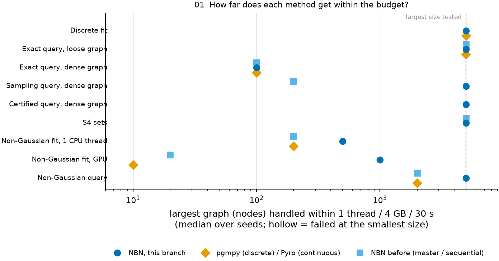
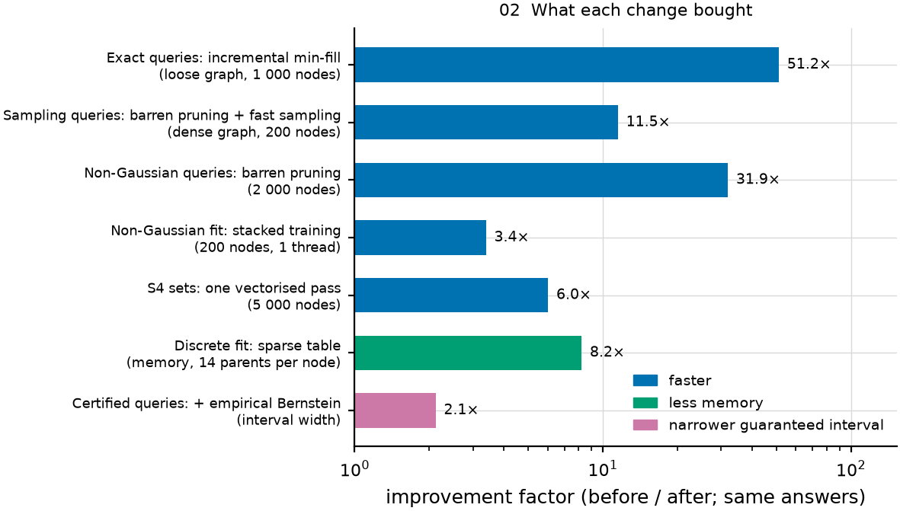
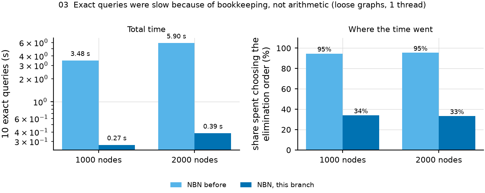
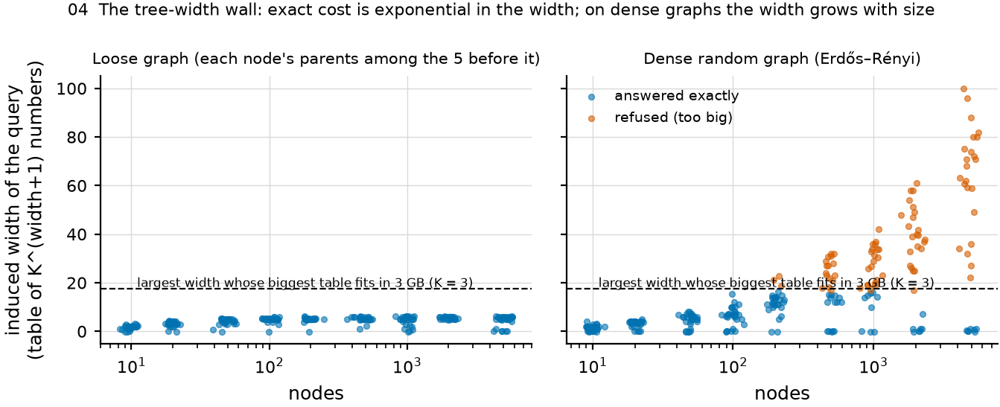
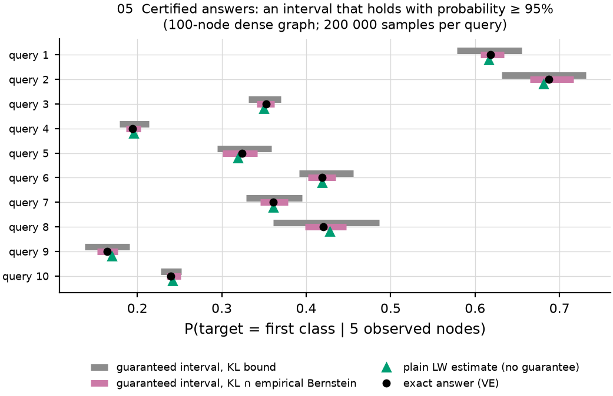
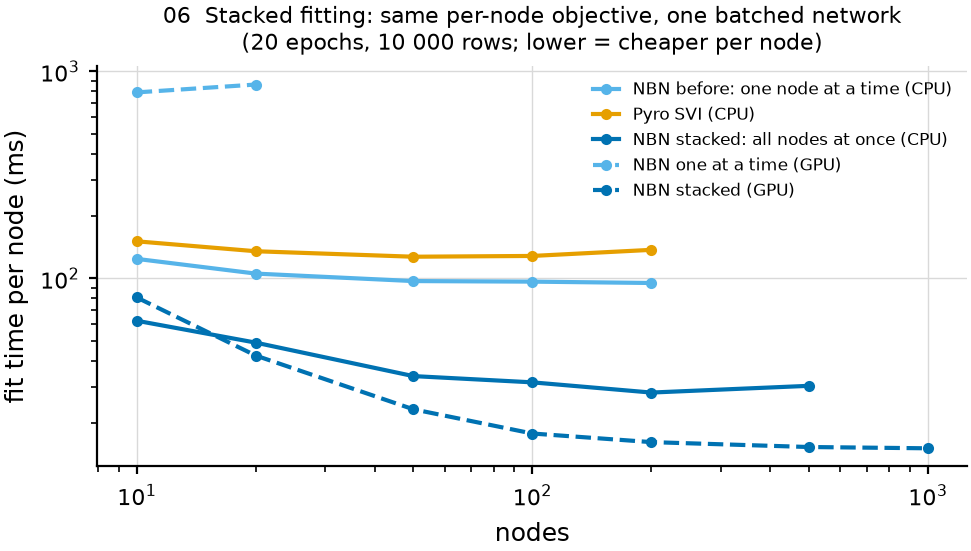
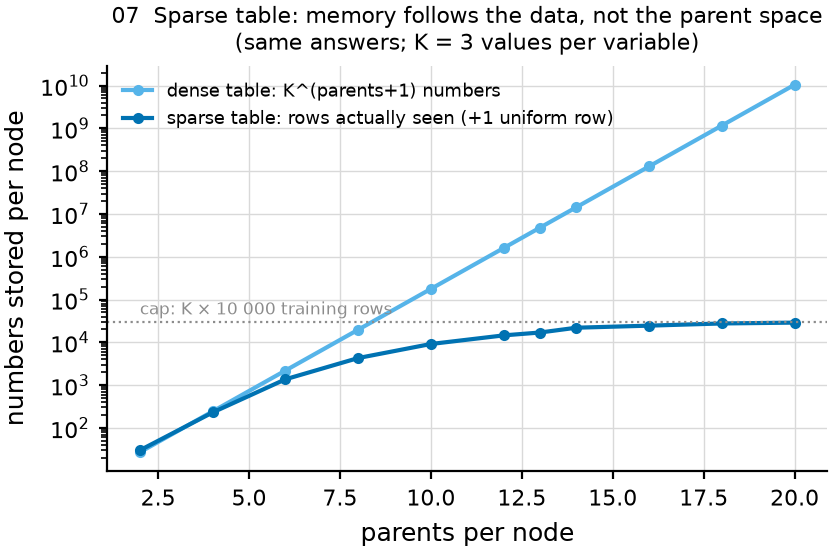
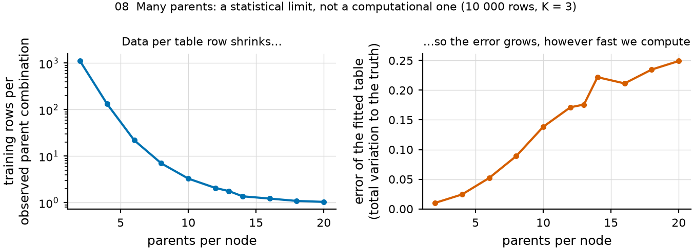
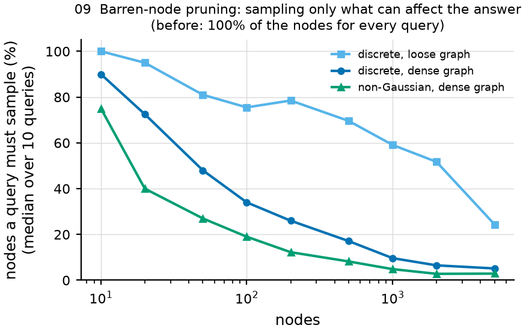

# What was done, in nine plots — with the numbers

Each section: one question, its plot, the numbers behind it, and what they say.
Words used: **loose graph** = each node's parents are among the 5 nodes just before it (tree-width ≤ 5 at any size); **dense graph** = parents drawn from all earlier nodes (Erdős–Rényi; gets thicker as it grows); **budget** = 1 CPU thread, 4 GB, 30 s per run (GPU = Apple M5 via MPS); **before** = NBN `master`, or the old one-node-at-a-time training path.

Regenerate: `python benchmarks/scaling/explain.py` (plots) and `python benchmarks/scaling/report/quant_tables.py` (this file and the report tables).

## Q1. How far does each method get within the budget?

**Q1. Largest graph (nodes) handled within 1 thread / 4 GB / 30 s (median over seeds; 5000 = largest size tested)**

| task | NBN branch | NBN before | pgmpy / Pyro |
|---|---|---|---|
| Discrete fit | 5000 | n/a | 5000 |
| Exact query, loose graph | 5000 | 5000 | 5000 |
| Exact query, dense graph | 100 | 100 | 100 |
| Sampling query (LW), dense graph | 5000 | 200 | n/a |
| Certified query, dense graph | 5000 | n/a | n/a |
| S4 per-factor sets | 5000 | 5000 | n/a |
| Non-Gaussian fit, 1 thread | 500 | 200 | 200 |
| Non-Gaussian fit, GPU (MPS) | 1000 | 20 | 10 |
| Non-Gaussian query | 5000 | 2000 | 2000 |

*Exact queries count only if all 10 queries are answered exactly.*

**What the numbers say.** Every row the branch improved now reaches the largest size tested (5 000 nodes), except exact queries on dense graphs (100 nodes for every library) and neural fitting (500 nodes on 1 thread, 1 000 on the GPU), where the cost is intrinsic. Sampling queries went from 200 to 5 000 nodes; non-Gaussian fitting on the GPU from 20 to 1 000.

## Q2. What did each change buy?

**Q2. Before / after for each change (same answers)**

| change | setting | before | after | factor |
|---|---|---|---|---|
| Incremental min-fill | exact, loose, 1000 nodes (s) | 3.66 | 0.0714 | 51.2× |
| Incremental min-fill | exact, loose, 2000 nodes (s) | 6.08 | 0.186 | 32.7× |
| Barren pruning + inverse CDF | LW, dense, 200 nodes (s) | 17.8 | 1.55 | 11.5× |
| Barren pruning + inverse CDF | LW, loose, 200 nodes (s) | 15.8 | 3.45 | 4.6× |
| Barren pruning | non-Gaussian LW, 2000 nodes (s) | 20.5 | 0.643 | 31.9× |
| Stacked fit | non-Gaussian, 200 nodes (s) | 19 | 5.62 | 3.4× |
| Batched interval sets | 5000 nodes (s) | 6.27 | 1.04 | 6.0× |
| Sparse table | 14 parents, peak memory (MB) | 2 601 | 317 | 8.2× |
| + empirical Bernstein | certified width, median of all queries | 0.074 | 0.0349 | 2.1× |

**What the numbers say.** Same answers, 3.4× to 51× faster, 8× less memory, and guaranteed intervals 2× narrower. The largest gains come from removing bookkeeping (ordering, sampling nodes that cannot matter), not from faster arithmetic.

## Q3. Why were exact queries slow?

**Q3. Ten exact queries on loose graphs: total time and time spent choosing the elimination order (1 thread)**

| nodes | code | total (s) | ordering (s) | ordering share |
|---|---|---|---|---|
| 1000 | before | 3.48 | 3.3 | 95% |
| 1000 | branch | 0.27 | 0.0921 | 34% |
| 2000 | before | 5.9 | 5.64 | 95% |
| 2000 | branch | 0.386 | 0.129 | 33% |

**What the numbers say.** Before, 95% of the time went into choosing the elimination order. The incremental version returns the identical order; the ordering share drops to about a third and the total time by 13–15× in this measurement.

## Q4. Why can't exact inference scale on dense graphs?

**Q4. Width of exact queries, loose graph (3 seeds × 10 queries; a width above 17.7 cannot fit 3 GB with K = 3)**

| nodes | median width | max width | median lower bound | answered exactly | refused | proven infeasible |
|---|---|---|---|---|---|---|
| 10 | 2 | 3 | 2 | 30/30 | 0 | 0 |
| 20 | 3 | 4 | 3 | 30/30 | 0 | 0 |
| 50 | 4.5 | 5 | 4 | 30/30 | 0 | 0 |
| 100 | 5 | 6 | 5 | 30/30 | 0 | 0 |
| 200 | 5 | 6 | 5 | 30/30 | 0 | 0 |
| 500 | 5 | 6 | 5 | 30/30 | 0 | 0 |
| 1000 | 5 | 6 | 5 | 30/30 | 0 | 0 |
| 2000 | 6 | 6 | 5 | 30/30 | 0 | 0 |
| 5000 | 5 | 6 | 5 | 30/30 | 0 | 0 |

**Q4. Width of exact queries, dense graph (3 seeds × 10 queries; a width above 17.7 cannot fit 3 GB with K = 3)**

| nodes | median width | max width | median lower bound | answered exactly | refused | proven infeasible | pgmpy answered |
|---|---|---|---|---|---|---|---|
| 10 | 1.5 | 4 | 1.5 | 30/30 | 0 | 0 | 30/30 |
| 20 | 4 | 5 | 4 | 30/30 | 0 | 0 | 30/30 |
| 50 | 6 | 8 | 5 | 30/30 | 0 | 0 | 30/30 |
| 100 | 7 | 15 | 6 | 30/30 | 0 | 0 | 30/30 |
| 200 | 12.5 | 23 | 8 | 27/30 | 3 | 0 | 0 (oom) |
| 500 | 17.5 | 32 | 9 | 14/30 | 16 | 0 | — |
| 1000 | 20.5 | 42 | 9.5 | 9/30 | 21 | 0 | — |
| 2000 | 36 | 61 | 13 | 7/30 | 23 | 0 | — |
| 5000 | 60 | 100 | 16 | 7/30 | 23 | 8 | — |

**What the numbers say.** On loose graphs the width stays at 5–6 at any size, so all 300 queries are exact. On dense graphs the median width grows from 2 to 60 and the maximum to 100; beyond 17.7 no table fits in 3 GB. At 5 000 nodes 23 of 30 queries are refused; 8 are proven infeasible by the lower bound alone. pgmpy fails already at 200 nodes.

## Q5. What does a certified answer look like?

**Q5. Certified answers vs exact answers (all queries where exact VE answered)**

| arm | queries | covered | median abs. error | max abs. error | median width | 90% width |
|---|---|---|---|---|---|---|
| plain LW, 100k samples (no guarantee) | 568 | n/a | 0.00273 | 0.0109 | — | — |
| certified, KL bound, 200k | 518 | 518/518 | 0.00187 | 0.00732 | 0.0673 | 0.122 |
| certified, KL ∩ Bernstein, 200k | 528 | 528/528 | 0.00186 | 0.00691 | 0.0328 | 0.051 |

**Q5. Time for 10 certified queries (200k samples each, s)**

| nodes | dense graph | loose graph |
|---|---|---|
| 10 | 0.474 | 0.493 |
| 20 | 0.858 | 0.992 |
| 50 | 1.5 | 2.15 |
| 100 | 2.39 | 4.2 |
| 200 | 3.66 | 7.56 |
| 500 | 5.54 | 13.8 |
| 1000 | 6.49 | 16.8 |
| 2000 | 9.18 | 18.8 |
| 5000 | 14.9 | 29.9 |

**What the numbers say.** Every one of the 528 guaranteed intervals contains the exact answer (95% was promised). Intersecting with an empirical-Bernstein bound halves the median width (0.067 → 0.033) at no cost in coverage. A certified query on a 5 000-node dense graph takes 1.5 s.

## Q6. Why is stacked fitting faster, and why does it help on the GPU?

**Q6. Non-Gaussian fit time per node (ms) and fit quality (same model, 20 epochs, 10 000 rows)**

| nodes | local CPU | stacked CPU | Pyro CPU | local GPU | stacked GPU | stacked 10 thr. | LL gap stacked | LL gap local | LL gap Pyro |
|---|---|---|---|---|---|---|---|---|---|
| 10 | 124 | 62.4 | 151 | 791 | 80.9 | 76.3 | 0.0243 | 0.0149 | 0.0153 |
| 20 | 105 | 48.9 | 135 | 863 | 42.4 | 52.2 | 0.0269 | 0.0293 | 0.0235 |
| 50 | 97.1 | 33.7 | 127 | timeout | 23.3 | 39.1 | 0.0244 | 0.0332 | 0.0294 |
| 100 | 96.5 | 31.5 | 128 | — | 17.8 | 30.5 | 0.0317 | 0.0313 | 0.0303 |
| 200 | 95 | 28.1 | 137 | — | 16.2 | 22.9 | 0.035 | 0.0334 | 0.0344 |
| 500 | timeout | 30.3 | timeout | — | 15.3 | 20.7 | 0.0347 | — | — |
| 1000 | — | timeout | — | — | 15.1 | 18.6 | — | — | — |
| 2000 | — | — | — | — | timeout | timeout | — | — | — |

*LL gap = true minus fitted median per-row test log-likelihood, nats per node.*

**What the numbers say.** Per node, stacked training costs about 30 ms on one CPU thread against 95 ms (sequential) and 130 ms (Pyro), and 15 ms on the GPU, where sequential training costs 800+ ms per node. Fit quality is the same (gaps 0.015–0.035 nats per node for all three).

## Q7. How does the sparse table save memory?

**Q7. Table size and measured cost vs number of parents (30 nodes, K = 3)**

| parents | dense numbers/node | sparse numbers/node | time dense (s) | time sparse (s) | time pgmpy (s) | RSS dense (MB) | RSS sparse (MB) |
|---|---|---|---|---|---|---|---|
| 2 | 27 | 30 | 0.0151 | 0.0187 | 0.0266 | 299 | 307 |
| 4 | 243 | 230 | 0.019 | 0.0274 | 0.0361 | 298 | 307 |
| 6 | 2 187 | 1 367 | 0.0251 | 0.0359 | 0.0626 | 300 | 309 |
| 8 | 19 683 | 4 288 | 0.0235 | 0.0359 | 0.339 | 311 | 311 |
| 10 | 177 147 | 9 133 | 0.0429 | 0.0433 | 2.79 | 344 | 314 |
| 12 | 1 594 323 | 14 516 | 0.182 | 0.0475 | 25.4 | 570 | 316 |
| 13 | 4 782 969 | 16 942 | 0.45 | 0.0485 | timeout | 1 147 | 315 |
| 14 | 14 348 907 | 21 936 | 1.29 | 0.0453 | — | 2 601 | 317 |
| 16 | 129 140 163 | 24 513 | oom | 0.0473 | — | 4 419 | 316 |
| 18 | 1 162 261 467 | 27 572 | — | 0.0505 | — | — | 320 |
| 20 | 10 460 353 203 | 28 849 | — | 0.0557 | — | — | 311 |

**What the numbers say.** At 20 parents the full table would need 10 billion numbers per node; the sparse table stores 28 849 and the process stays at ≈ 0.3 GB. pgmpy times out at 13 parents, the dense NBN table runs out of memory at 16.

## Q8. Then is "many parents" solved?

**Q8. Data fragmentation: rows per observed parent combination and error of the fitted table (10 000 rows)**

| parents | rows per combination | TV error (all methods identical) |
|---|---|---|
| 2 | 1 111 | 0.01 |
| 4 | 132 | 0.0243 |
| 6 | 22 | 0.0521 |
| 8 | 7 | 0.089 |
| 10 | 3.29 | 0.138 |
| 12 | 2.07 | 0.171 |
| 13 | 1.77 | 0.176 |
| 14 | 1.37 | 0.222 |
| 16 | 1.22 | 0.211 |
| 18 | 1.09 | 0.235 |
| 20 | 1.04 | 0.249 |

**What the numbers say.** No: with 20 parents a parent combination is seen about once, and the fitted table's error grows 25× (0.010 → 0.249) whatever the speed. That limit needs a different model type.

## Q9. Why are sampling queries so much faster?

**Q9. Share of nodes a sampling query must touch, and LW time (10 queries, before / after)**

| nodes | touched, loose | touched, dense | touched, non-Gauss. | LW dense before (s) | LW dense after (s) | non-Gauss. before (s) | non-Gauss. after (s) |
|---|---|---|---|---|---|---|---|
| 10 | 100% | 90% | 75% | 0.499 | 0.22 | 0.0874 | 0.05 |
| 20 | 95% | 72% | 40% | 1.33 | 0.379 | 0.19 | 0.0662 |
| 50 | 81% | 48% | 27% | 4.02 | 0.629 | 0.509 | 0.128 |
| 100 | 76% | 34% | 19% | 8.79 | 1.04 | 1.01 | 0.169 |
| 200 | 78% | 26% | 12% | 17.8 | 1.55 | 2.03 | 0.218 |
| 500 | 70% | 17% | 8% | timeout | 2.78 | 4.98 | 0.406 |
| 1000 | 59% | 10% | 5% | timeout | 3.25 | 10.1 | 0.49 |
| 2000 | 52% | 6% | 3% | timeout | 4.69 | 20.5 | 0.643 |
| 5000 | 24% | 5% | 3% | timeout | 7.75 | timeout | 1.8 |

**What the numbers say.** A query only needs the ancestors of its target and evidence: 5% of a 5 000-node dense graph (3% non-Gaussian). Before, every query sampled every node and timed out at 500 (discrete) or 5 000 (non-Gaussian) nodes.
